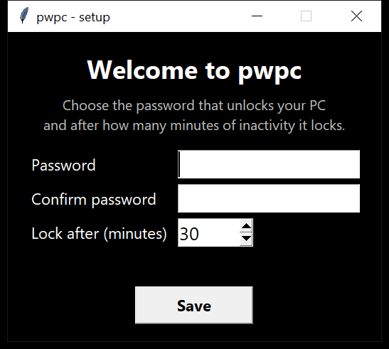

# pwpc — idle password lock for Windows

pwpc locks your PC behind a password after a period of inactivity.
When nobody touches the mouse or keyboard for the time you chose, a full-screen,
always-on-top black overlay covers **every connected monitor** and stays there
until the right password is typed.

I built it because the Windows lock screen didn't fit how I use my PC: I wanted
my own password, my own timeout, and a lock that covers both of my monitors.



## Features

- **First-run setup**: the first time you open it, pwpc asks you to choose the
  password and how many minutes of inactivity (1–1440) before it locks.
- **No clear-text password**: only a salted PBKDF2-SHA256 hash (200,000 iterations)
  is stored, in `%APPDATA%\pwpc\config.json`.
- **Multi-monitor**: the overlay covers the whole virtual screen, and the password
  box is centered on the primary monitor.
- **DPI-aware**: works with Windows scaling at 125%/150% and mixed-DPI setups.
- **Stays on top**: it re-asserts focus and top-most state every 500 ms, and blocks
  Alt+F4, Esc and Ctrl+W (best effort: Ctrl+Alt+Del still works, as it should).
- **Change settings anytime** with `--setup`; a running instance picks up the new
  settings within a few seconds, no restart needed.
- **No dependencies**: pure Python standard library (tkinter + ctypes).

## Download

Grab `pwpc.exe` from the [Releases](../../releases) page: no Python needed, double-click it
and the setup window opens. Put a shortcut to it in `shell:startup` to run it at every sign-in.

## Requirements (to run from source)

- Windows 10/11
- Python 3.10+ (with tkinter, included in the standard installer)

## Usage

```powershell
# run it in the background (the first run opens the setup window)
pythonw lock_screen.py

# start it automatically at every Windows sign-in
powershell -ExecutionPolicy Bypass -File install_autostart.ps1

# change password / inactivity time
powershell -ExecutionPolicy Bypass -File change_settings.ps1

# see the lock screen right away (exits after unlocking)
powershell -ExecutionPolicy Bypass -File test_lock_now.ps1
```

To stop using it, delete the `pwpc.lnk` shortcut from `shell:startup` and,
if you want, the `%APPDATA%\pwpc` folder.

## How it works

- Inactivity is measured system-wide with `GetLastInputInfo`, masking the
  32-bit tick counter so it keeps working after the ~49.7-day wrap-around.
- The overlay is a borderless tkinter window sized to the virtual screen
  (`SM_XVIRTUALSCREEN`…`SM_CYVIRTUALSCREEN`), so it also handles monitors placed
  left of or above the primary one.

## Limitations

pwpc is a convenience lock, not a security boundary: anyone who can sign out,
use Task Manager via Ctrl+Alt+Del or reboot the PC can get past it. For real
protection keep using your Windows account password (Win+L).

## License

MIT — see [LICENSE](LICENSE).
